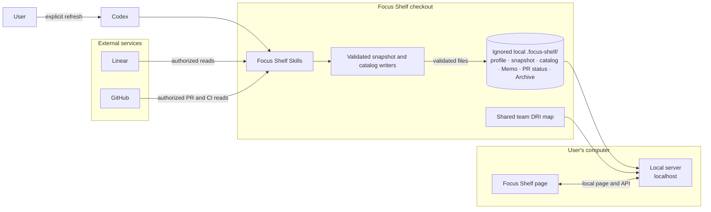

# Focus Shelf

## Architecture



The page reads local files; it does not connect to Linear or GitHub. Codex refreshes them only when asked. By default, personal data stays in the Git-ignored `.focus-shelf/` folder of this checkout; `FOCUS_SHELF_HOME` can still select a different absolute directory. Memo, manual PR selections and Archive are saved in `memos.json`, `pr-status.json` and `archive.json` there, shared by browsers opening the same local shelf. Previously browser-only Archive entries are imported when that original browser next opens the shelf, provided no shared Archive file exists yet. After a verified snapshot refresh, an archived parent moves to Completed when its whole visible family is Done, PR discovery is complete and no associated PR remains Open. An open PR defaults to Open; a non-Draft PR becomes Ready for Review when current-head CI has passed, ignoring skipped checks and treating Release target policy failure as a warning. Manual PR selections remain saved across refreshes: if you choose Merged or Closed but GitHub still says Open, the page reminds you; verified GitHub Merged/Closed takes precedence once it happens. To try another person's shelf, use a different local data folder and port so the first person's files stay untouched. Back up `.focus-shelf/` before deleting or replacing the checkout; Git does not back it up.

## Quick Start

**Needs:** Node.js 22+, a current browser, and Codex with the bundled `focus-shelf` and `generate-focus-shelf-icon` Skills. Add authorized Linear access for issue refresh; add GitHub CLI or connector access for PR/CI details.

1. Clone this repository and open its folder.
2. Create your local profile config in the ignored data folder:

   ```sh
   mkdir -p .focus-shelf
   cp examples/config.example.json .focus-shelf/config.json
   ```

   Edit `.focus-shelf/config.json`: replace the demo profile, Linear owner and workspace with your own values. An existing installation using `FOCUS_SHELF_HOME` keeps using that directory; this change does not move its files.
3. Start the shelf:

   ```sh
   npm start
   ```

4. Open [http://localhost:8770](http://localhost:8770). Use **Update** and paste the request into Codex to refresh; reloading the page only rereads local files.
