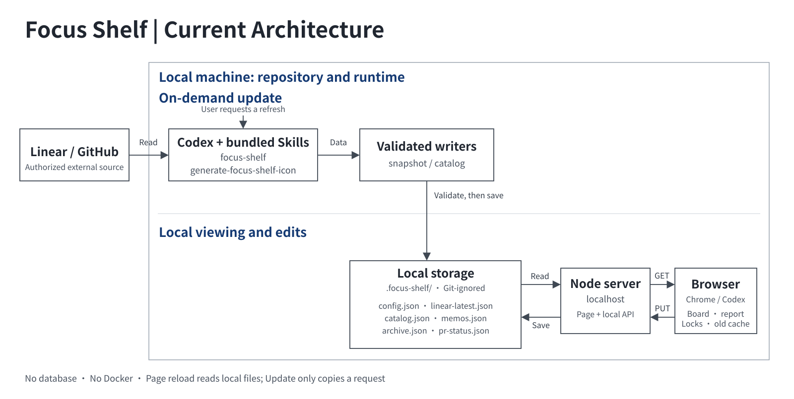

# Focus Shelf

A local, on-demand view of your Linear tickets and related GitHub PRs. Codex gathers updates when you ask; the page does not sync with either service on its own.

## Architecture



No database or Docker. The local server serves the page and reads the Git-ignored `.focus-shelf/` folder. Memo, Archive, and manual PR selections are saved there, so they remain available across browsers using the same local shelf.

## Before you start

- Node.js 22+, Git, a browser, and Codex with access to this checkout.
- Required for a real shelf: an authorized Linear connector/MCP that Codex can use to read the complete ticket scope in your workspace.
- For PR and CI details: an authenticated GitHub CLI (`gh`) or authorized GitHub connector/MCP with access to the relevant repositories. No particular GitHub Skill is required. Without this access, tickets can still appear, but PR/CI coverage remains unverified.
- Codex can help confirm your Linear owner and GitHub identity. Sign in through the integrations as needed; never put credentials in this repository.

## Quick start with Codex

Paste this into Codex. It will clone the repository and set up your own shelf:

```text
Set up my personal Focus Shelf from https://github.com/ShengHuang21/focus-shelf.git; clone it if needed. Follow this repository's bundled focus-shelf and generate-focus-shelf-icon Skills and CODEX_SNAPSHOT.md, not personal defaults.

Check that Codex has authorized Linear MCP/connector access to my complete ticket scope; tell me what to connect if it does not. Confirm my workspace, owner, and timezone from my account, asking about any unclear identity details. Use an authenticated GitHub CLI or connector for PR/CI if available; otherwise mark PR/CI coverage unavailable, not “no PRs.”

Keep my config and data in the Git-ignored .focus-shelf/ folder and preserve any existing setup. Use verified account data, not the demo. Run the complete first refresh through the repository writers and validate before saving. If Linear coverage is incomplete, preserve existing data or leave a new shelf without snapshot/catalog, and explain the gap. Start the local server and show me its URL.
```

## Manual quick start (demo)

```sh
git clone https://github.com/ShengHuang21/focus-shelf.git
cd focus-shelf
mkdir -p .focus-shelf
cp examples/config.example.json .focus-shelf/config.json
cp examples/snapshot.example.json .focus-shelf/linear-latest.json
cp examples/catalog.example.json .focus-shelf/catalog.json
npm start
```

Open [http://localhost:8770](http://localhost:8770). This runs a local demo only; it does not sign in to Linear or GitHub or fetch your tickets. To build your own shelf, use the Codex setup prompt above.

## Keeping it current

Ask Codex in ordinary language, for example:

- “Update ELT-536 in my Focus Shelf.”
- “Check PR #163 and update its linked ticket in my Focus Shelf.”
- “Update my whole Focus Shelf, including tickets and related PRs.”

The bundled Skill handles a scoped update or an incremental whole-shelf refresh and validates the local files before saving. You can also use the page's **Update** button to copy a request for Codex, but it is optional: the button does not fetch Linear or GitHub data. Reloading the page only rereads the latest local files.

Git ignores your `.focus-shelf/` data by default. Back it up before deleting the checkout. Use a separate local data folder and port when trying another person's shelf.
