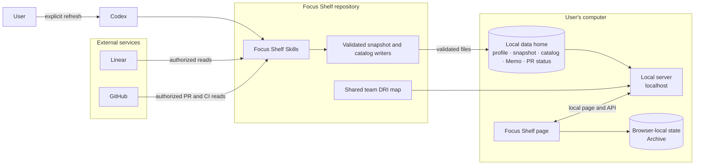

# Focus Shelf

## Architecture



The page reads local files; it does not connect to Linear or GitHub. Codex refreshes them only when asked. Memo and manual PR selections are saved in `FOCUS_SHELF_HOME/memos.json` and `FOCUS_SHELF_HOME/pr-status.json` on this computer, shared by browsers opening the same local shelf. Archive stays in each browser. An open PR defaults to Open; a non-Draft PR becomes Ready for Review when current-head CI has passed, ignoring skipped checks and treating Release target policy failure as a warning. Manual PR selections remain saved across refreshes: if you choose Merged or Closed but GitHub still says Open, the page reminds you; verified GitHub Merged/Closed takes precedence once it happens. To try another person's shelf, use a different local data folder and port so the first person's files stay untouched.

## Quick Start

**Needs:** Node.js 22+, a current browser, and Codex with the bundled `focus-shelf` and `generate-focus-shelf-icon` Skills. Add authorized Linear access for issue refresh; add GitHub CLI or connector access for PR/CI details.

1. Clone this repository and open its folder.
2. Create your local data folder and profile config outside the repository:

   ```sh
   mkdir -p "$HOME/.focus-shelf"
   cp examples/config.example.json "$HOME/.focus-shelf/config.json"
   ```

   Edit `~/.focus-shelf/config.json`: replace the demo profile, Linear owner and workspace with your own values.
3. Start the shelf:

   ```sh
   export FOCUS_SHELF_HOME="$HOME/.focus-shelf"
   npm start
   ```

4. Open [http://localhost:8770](http://localhost:8770). Use **Update** and paste the request into Codex to refresh; reloading the page only rereads local files.
